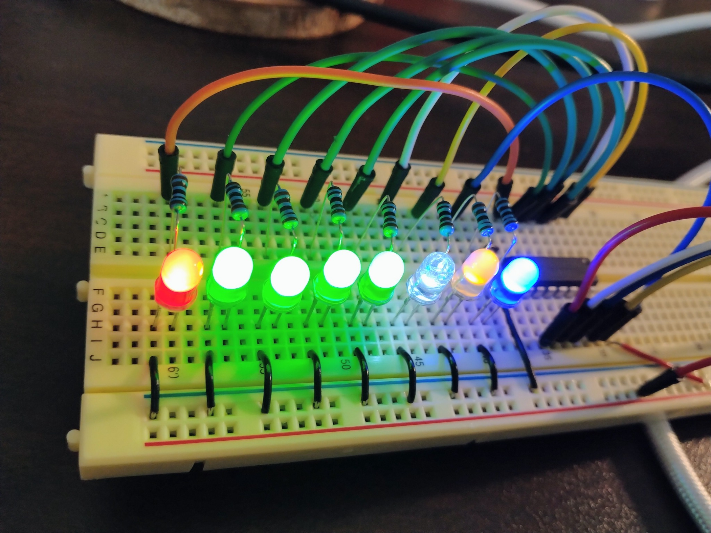

# hello_atomvm_74hc595

Seeed Studio XIAO ESP32-C5 上の AtomVM から、SN74HC595N（8-bit シフトレジスター）を使って **8 個の LED を 3 本の GPIO 信号で動かす**実験です。ブレッドボードだけで組み立てられます。



2026-11-05 までに、実機で **8 灯の同時点灯と全消灯への遷移**を確認しました。通常デモを実機へ書き込み、シリアルログでも 1 周分の出力を確認済みです。個別の LED と往復点灯の順序は、まだ目視確認の途中です。詳細は [実機記録](docs/worklog/README.md) にまとめています。

## 用意するもの

- Seeed Studio XIAO ESP32-C5 ×1、USB-C データケーブル ×1
- SN74HC595N（DIP-16）×1
- LED ×8、**1 kΩ 抵抗 ×8**
- **0.1 µF セラミックコンデンサ ×1**、ブレッドボード、ジャンパーワイヤー

**配線するときは USB ケーブルを抜いてください。** XIAO の `5V` ではなく `3V3` を使います。

## 最初に確認する配線

| XIAO ESP32-C5 | SN74HC595N | 役割 |
| --- | --- | --- |
| `3V3` | **16 / VCC** | 電源 |
| `GND` | **8 / GND** | 共通 GND |
| `3V3` | **10 / SRCLR** | リセットを解除。**忘れやすい** |
| `GND` | **13 / OE** | LED 出力を有効にする |
| `D10 / GPIO10` | 14 / SER | データ |
| `D8 / GPIO8` | 11 / SRCLK | シフトクロック |
| `D9 / GPIO9` | 12 / RCLK | ラッチクロック |

LED はそれぞれ **IC の出力 → 1 kΩ → LED (+) → LED (−) → GND** と接続します。

IC の向きやピンの数え方、XIAO の実物に合わせたピン配置は **[写真付きの配線ガイド](docs/hardware.md)** を見てください。ピン番号だけを見て配線しないようにしています。

## 動かす

```sh
# ホスト PC で実行。GPIO や実機は不要
make check
make demo

# AtomVM をインストール済みの XIAO ESP32-C5 へ書き込む
mix deps.get
mix atomvm.esp32.info
mix atomvm.esp32.flash --port /dev/ttyACM0
mix atomvm.esp32.monitor --port /dev/ttyACM0
```

ポートは環境に合わせて変更してください。AtomVM 本体の導入手順と注意点は [開発・再現手順](docs/development.md) にあります。

通常のデモは次の順番で繰り返します。

1. 全灯 → 消灯（配線を一目で確認）
2. `QA → QB → … → QH → … → QB → QA`（1 灯ずつ、600 ms）
3. 奇数側／偶数側の LED を交互に点灯
4. 全灯 → 消灯

### うまく点灯しないとき

一度にすべてを調べず、**診断モード**で出力を固定して確認できます。

```sh
# 全灯を保つモードでビルド・書き込み
LED_DEMO_MODE=all_on mix clean
LED_DEMO_MODE=all_on mix atomvm.esp32.flash --port /dev/ttyACM0
```

`all_on` のほか `all_off`、`qa`（QA だけ）、`qh`（QH だけ）、`demo`（通常）が使えます。モードを変えるときは `mix clean` してから書き込んでください。`LED_DEMO_MODE=demo` が既定値です。

チェックすべき順番は **VCC pin 16 → GND pin 8 → SRCLR pin 10 → OE pin 13 → 3 本の信号線 → LED の極性と抵抗**です。詳細は [トラブルシューティング](docs/development.md#うまくいかないとき) を参照してください。

## リポジトリ構成

```text
lib/                   AtomVM entrypoint、シフトレジスター制御、LED パターン
config/                ビルド時のデモモード
scripts/               ホストで動くテストとパターンプレビュー
test/                  GPIO を模擬した単体テスト
docs/hardware.md       実物のピン配置、LED の接続、配線チェック
docs/development.md    ホストテスト、書き込み、診断
docs/architecture.md   8-bit 転送とラッチの仕組み
docs/worklog/          実機の確認記録
```

文書の入口は [docs/README.md](docs/README.md) です。

## 参考資料

- [Seeed Studio: XIAO ESP32-C5 pin map](https://wiki.seeedstudio.com/xiao_esp32c5_getting_started/#pin-map)
- [Texas Instruments: SN74HC595 データシート](https://www.ti.com/lit/ds/symlink/sn74hc595.pdf)
- [AtomVM GPIO API](https://doc.atomvm.org/release-0.7/programmers-guide.html#gpio)
