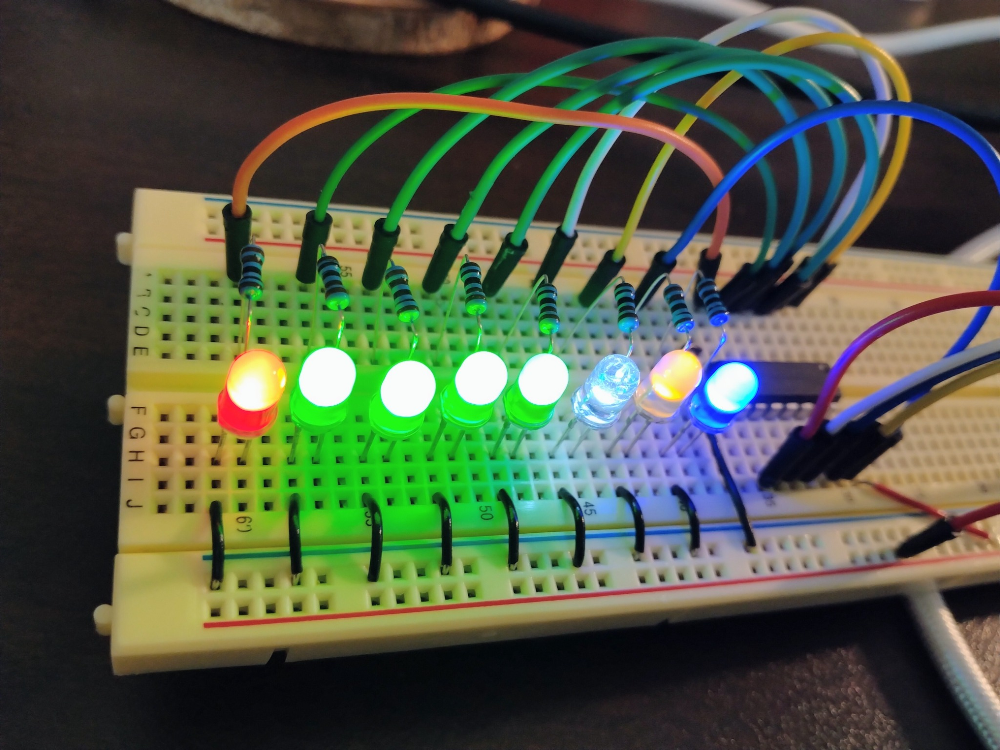
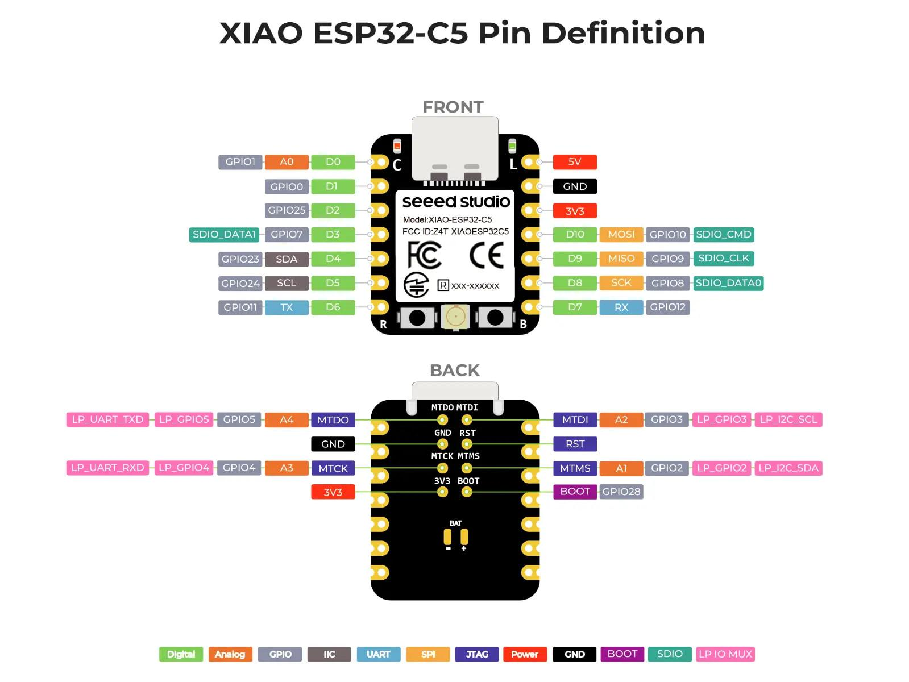
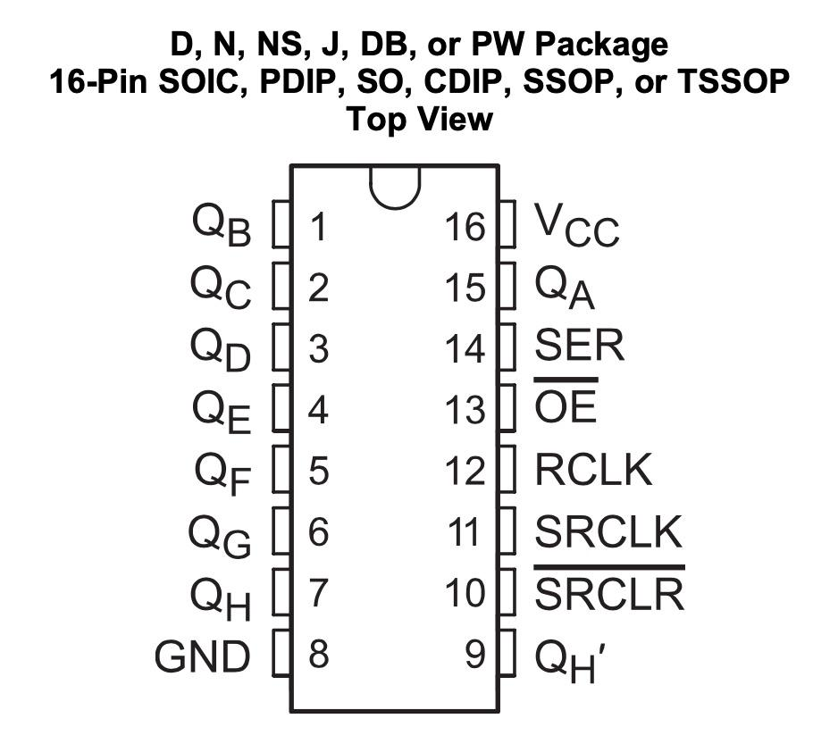

# ブレッドボード配線ガイド

XIAO ESP32-C5、SN74HC595N、LED 8 個を初めて組み立てる人向けの手順です。**ピン番号は IC の向きを確認してから数えます。** 配線を動かす前に USB を抜いてください。



この写真では 8 個の LED が点灯しています。別の[短い動画](assets/breadboard-leds-on-off.mp4)では全灯と全消灯への遷移も確認できました。ただし、**各 LED と QA〜QH の対応や往復点灯の順番は未確認**です。

## 1. 用意するもの

| 部品 | 数 | 用途 |
| --- | ---: | --- |
| XIAO ESP32-C5 | 1 | AtomVM を動かすマイコン |
| SN74HC595N（DIP-16） | 1 | 3 本の信号から 8 出力を作る |
| LED | 8 | 色は自由 |
| **1 kΩ 抵抗** | **8** | LED 1 個につき 1 本 |
| 0.1 µF セラミックコンデンサ | 1 | IC の電源ノイズを抑える |
| ブレッドボードとジャンパーワイヤー | 適量 | 配線用 |
| USB-C データケーブル | 1 | 給電とアプリ書き込み |

## 2. XIAO ESP32-C5 のピンを見つける

まず XIAO の表面（Seeed Studio のロゴがある面）を上にして、**USB-C コネクターを右側**へ向けます。これは冒頭のブレッドボード写真と同じ向きです。

```text
                                   USB-C
                                    →
       ┌───────────────────────────────┐
       │  XIAO ESP32-C5（表を上に）    │
       └───────────────────────────────┘
 下側:     D7  D8  D9  D10  3V3  GND  5V
                │   │   │    │    │    └─ 使わない
                │   │   │    │    └────── GND
                │   │   │    └─────────── 3.3 V 電源
                │   │   └──────────────── SER（データ）
                │   └──────────────────── RCLK（ラッチ）
                └──────────────────────── SRCLK（クロック）
```

`D8`、`D9`、`D10` は基板上の呼び名です。AtomVM の GPIO API に渡す番号はそれぞれ **GPIO8、GPIO9、GPIO10** です。`3V3` は USB コネクター側から **3 番目**、`GND` は **2 番目**です。**`5V`（一番端）へは接続しません。**



上の公式図は **USB-C が上**なので、ブレッドボードとは 90° 向きが違います。向きを変えるときは印字と USB-C の位置を基準にしてください。

## 3. SN74HC595N の 16 本のピンを数える

SN74HC595N をブレッドボードの**中央の溝をまたぐ位置**に挿します。IC 上面にある小さな**切り欠き（半円の notch）**か pin 1 の印を探します。

**上から見て切り欠きが上にある場合：**

```text
                      notch
                    ┌── U ──┐
         QB       1 │       │ 16  VCC    → 3V3
         QC       2 │       │ 15  QA     → LED 1
         QD       3 │       │ 14  SER    → D10
         QE       4 │       │ 13  OE     → GND
         QF       5 │       │ 12  RCLK   → D9
         QG       6 │       │ 11  SRCLK  → D8
         QH       7 │       │ 10  SRCLR  → 3V3  ★
         GND      8 │_______│  9  QH'    → 未接続
```

**切り欠きが左を向いた横置きの場合：** ピン番号は以下のように並びます。

```text
                           IC を上から見た図
             ┌─────────────────────────────────────┐
   notch  ◀ U│ 16  15  14  13  12  11  10   9   │ 上側の列
             │  1   2   3   4   5   6   7   8   │ 下側の列
             └─────────────────────────────────────┘
```

切り欠きが右側なら、この番号の並びは逆になります。**写真の左右端だけで pin 16 を決めないでください。**



`QH'`（pin 9）は次のシフトレジスター用のシリアル出力で、今回使う `QH`（pin 7）とは別物です。

## 4. 最重要：電源と enable/reset を先につなぐ

この **4 本の配線がないと LED は正常に光りません**。

| SN74HC595N | 接続先 | なぜ必要か |
| --- | --- | --- |
| **pin 16: VCC** | XIAO `3V3` | IC の電源 |
| **pin 8: GND** | XIAO `GND` | IC の GND |
| **pin 10: SRCLR** | XIAO `3V3` | HIGH にしてクリアを解除 |
| **pin 13: OE** | XIAO `GND` | LOW にして 8 出力を有効化 |

**重要：pin 10 と pin 13 は逆の電位です。** `SRCLR` は 3V3、`OE` は GND。どちらも空いたままにしません。2026-11-04 の実機トラブルでは pin 10 の 3V3 接続漏れが疑われ、接続後に全灯テストが成功しました。

0.1 µF コンデンサを **pin 16（VCC）と pin 8（GND）の間**に、できるだけ IC の近くで入れます。

## 5. 3 本の信号線をつなぐ

| XIAO（基板表記 / GPIO 番号） | SN74HC595N | 信号 |
| --- | --- | --- |
| `D10 / GPIO10` | pin 14 / SER | 送るデータ（0 または 1） |
| `D8 / GPIO8` | pin 11 / SRCLK | 1 bit ずつ取り込むクロック |
| `D9 / GPIO9` | pin 12 / RCLK | 8 bit を LED に反映するラッチ |

同じ番号の GPIO でも `D10`、`pin 10` は別の部品を指します。**XIAO の D10 は SN74HC595N の pin 14** につなぎます。

## 6. LED と抵抗を 1 組ずつつなぐ

```text
SN74HC595N の出力 ── [1 kΩ] ── LED の長い脚 (+)
                                   LED の短い脚 (−)
                                          │
                             青い GND レール（−）
                                          │
                                       XIAO GND
```

LED の脚をカットしている場合、長さだけで極性を判断せず、データシートやテスターで確認してください。**各 LED に 1 本ずつ抵抗が必要です。**

ブレッドボードの穴は次のようにつながっています。

```text
  A37 ─ B37 ─ C37 ─ D37 ─ E37    ← 同じ番号の 5 穴が導通
                  中央の溝       ← ここは導通しない
  F37 ─ G37 ─ H37 ─ I37 ─ J37    ← 同じ番号の 5 穴が導通

  37 行と 38 行は別々の電気的な列
```

例えば QA（pin 15）から青い LED 1 個をつなぐ場合：

1. QA からジャンパーを `A37` へ入れる。
2. **1 kΩ 抵抗を `E37` と `F37` の間**（中央の溝をまたぐ）に置く。
3. LED アノード (+) を `H37`、カソード (−) を `H38` に入れる。
4. `J38` から青い GND レールへジャンパーを入れる。
5. 青い GND レールを XIAO の `GND` へ接続する。

この例では LED の 2 本の脚を別の番号の行へ置くため、短絡しません。残りの LED も同じ考え方で組み立てます。

| 出力 | IC pin | 点灯パターン | 色の例（写真の配置） |
| --- | ---: | --- | --- |
| QA | 15 | `0x01` | 青（右端） |
| QB | 1 | `0x02` | 黄 |
| QC | 2 | `0x04` | 白 |
| QD | 3 | `0x08` | 緑 |
| QE | 4 | `0x10` | 緑 |
| QF | 5 | `0x20` | 緑 |
| QG | 6 | `0x40` | 緑 |
| QH | 7 | `0x80` | 赤（左端） |

色はあくまで配置例です。**写真と動画だけでは上表の出力と LED の対応を特定できないため、個別試験で確認します。**

GND レールに途中の切れ目があるブレッドボードもあります。端から端まで導通するかテスターで確認し、切れていればジャンパーでつなぎます。

## 7. USB を挿す前のチェック

- [ ] IC の切り欠きから **pin 1 と pin 16** を正しく数えた
- [ ] **pin 16 → 3V3、pin 8 → GND**
- [ ] **pin 10 → 3V3、pin 13 → GND**（忘れやすい 2 本）
- [ ] XIAO の **D10 → pin 14、D8 → pin 11、D9 → pin 12**
- [ ] LED **8 個それぞれに 1 kΩ** の直列抵抗がある
- [ ] LED の (+) と (−) が同じ接続グループに入っていない
- [ ] LED の GND レールが **XIAO GND** に接続されている
- [ ] IC の VCC–GND 間に **0.1 µF** コンデンサがある
- [ ] 3V3 と GND が短絡していない（可能ならテスターで確認）

配線ができたら [開発・再現手順](development.md) の `all_on` → `qa` → `qh` → `demo` の順に確認すると原因を絞りやすくなります。

## 資料

- [Seeed Studio: XIAO ESP32-C5 pin map](https://wiki.seeedstudio.com/xiao_esp32c5_getting_started/#pin-map)
- [Texas Instruments: SN74HC595 データシート](https://www.ti.com/lit/ds/symlink/sn74hc595.pdf)
