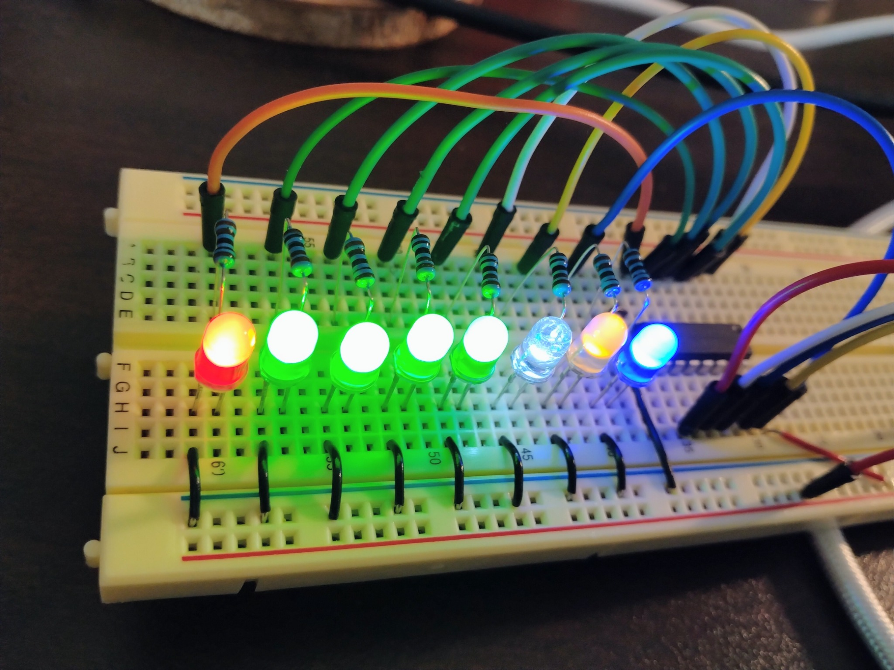

# 2026-11-04: 初回配線と全灯テスト

## 構成

- Seeed Studio XIAO ESP32-C5 ×1
- SN74HC595N（DIP-16）×1、LED ×8、LED 用の直列抵抗 ×8
- AtomVM: `v0.7.0-beta.0-19-ga1069573`（`mix atomvm.esp32.info` の表示）
- Linux ホスト、シリアルポート: `/dev/ttyACM0`（環境により異なる）
- USB 給電、ブレッドボード
- 抵抗値は配線計画上 1 kΩ。個別の実測はしていない
- 0.1 µF コンデンサの実装有無は写真だけでは確認できていない

## 実施・観測したこと

1. ホストの `make test` が **7 tests, 0 failures**。`make demo` もパターンを表示した。
2. `mix atomvm.esp32.info` で `ESP32-C5`、AtomVM installed を確認した。
3. `mix atomvm.esp32.flash --port /dev/ttyACM0` が完了した。
4. 当初、通常の往復点灯が期待どおりに見えなかった。
5. 診断として `0xFF`（すべて HIGH）を保持するアプリを書き込み、`{led_test,all_on}` のログを確認したが、LED は消灯していた。
6. 電源 (VCC pin 16、GND pin 8) の接続を確認した。その後、**SRCLR pin 10 → 3V3 の接続漏れ**が疑われ、配線を修正した。
7. 修正後の写真では **8 個の LED が点灯**している。

この結果から、pin 10 の接続漏れが原因だった可能性が高い。ただし全信号線の電圧を測定して原因を特定したわけではない。

## 重要な学び

- **pin 16 VCC → 3V3**、**pin 8 GND → GND** は当然必要。
- **pin 10 SRCLR → 3V3** も必要。LOW のままではシフトレジスターがクリアされる。
- **pin 13 OE → GND** にして出力を有効にする。
- ログに `ready` や `led_test` が出ても、物理 LED が点灯した証拠にはならない。

## 未確認

- `0x00` で全消灯すること
- `0x01`（QA）、`0x80`（QH）が意図した色の LED だけに対応すること
- 往復点灯・交互点灯が期待どおりに動くこと
- 電源レールの導通、各信号の電圧、コンデンサの取り付け状況

初回観測時のコードは全灯診断用。通常デモへの復帰後は別途実機確認が必要。
